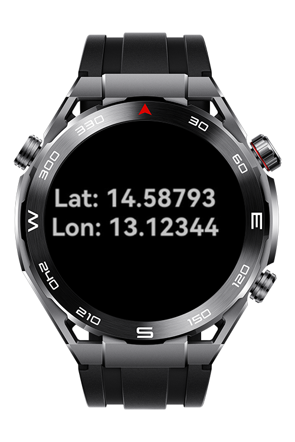

> **Note:** To access all shared projects, get information about environment setup, and view other guides, please visit [Explore-In-HMOS-Wearable Index](https://github.com/Explore-In-HMOS-Wearable/hmos-index).

# How To Show User Location at Lite

HarmonyOS application that retrieves the user's current location (latitude and longitude) using LocationKit and displays it cleanly on screen.

# Preview

<div>
  
</div>

# Use Cases

-  Real-time location fetching via `geoLocationManager`
-  Displays latitude and longitude in human-readable format


# Tech Stack

- **Languages**: JS
- **Frameworks**: HarmonyOS SDK 4.0.0(10)
- **Tools**: DevEco Studio Vers 5.1.0.842
- **Libraries**: @ohos.geolocation
  
# Directory Structure

```
entry/src/main/js/MainAbility
│    pages/
│     └── index.css
│     └── index.hml
│     └── index.js
└──  i18n
      ├── en-US.json
      └── zh-CN.json
└──  app.js
```

# Constraints and Restrictions

## Supported Devices

- Huawei Lite Wearable

# LICENSE

Show User Location Lite is distributed under the terms of the MIT License.
See the [LICENSE](/LICENSE) for more information.
